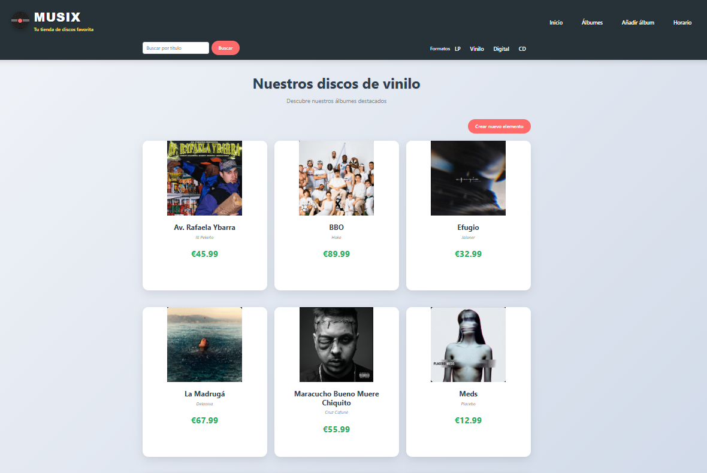
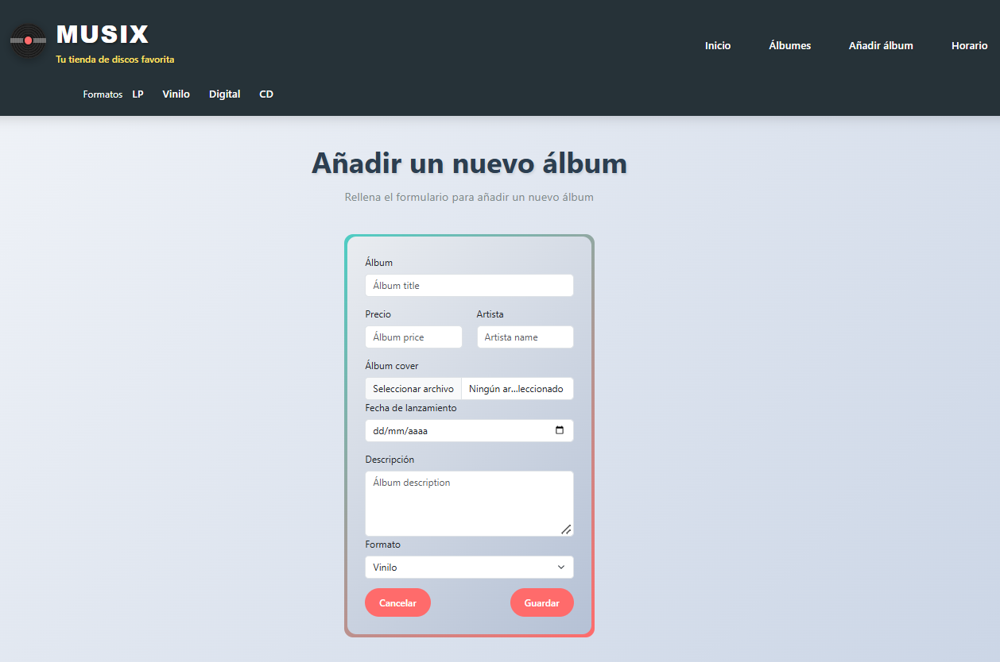

# webapp22
## Práctica 1

**MUSIX**

| Name  | Adress | Github |
| :-------------:|:-------------:| :-------------: |
|David Esteban Bernardo|d.estebanb.2022@alumnos.urjc.es|Daviid24x| 
|Cristobal Justo Rustarazo|c.justo.2019@alumnos.urjc.es|cristobalJR|

## **Funcionalidad**

### Entidades

**Entidad principal: `Album`**

Atributos:
* `album_title`
* `artist`
* `record_price`
* `cover_image`
* `description` 
* `release_date`
* `format` <!-- lp,vinilo,digital,cd -->

**Entidad secundaria: `Album Review`**

Atributos:
* `nickname`
* `review_date`
* `opinion`
* `rating` <!-- 1 a 5 estrellas -->

### Imágenes

Cada disco (`Album`) tendrá asociada una única imagen de portada (`cover_image`).

### Buscador, filtrado o categorización

Se podrán filtrar los albumes por título (`album_title`). Además, los discos estarán asociados a un formato (`format`), que permitirá organizarlos o consultarlos por artista.

## Documentación práctica 1

### Capturas de pantalla de las páginas

#### Página principal

#### Página de detalle

#### Página de nuevo elemento

### Participación de los miembros

#### David Esteban Bernardo

**Tareas realizadas:** Participé en la maquetación del catálogo de álbumes con el sistema de Bootstrap, en la página de detalle y sus reseñas, y en el formulario para añadir álbumes. También trabajé en los estilos responsive, cambién la interfaz a español, la actualización de las imágenes.

**Cinco commits más significativos:**
1. [Refactor branding from VINYL DEVS to MUSIX, update navigation links and create new album addition page](https://github.com/CodeURJC-FW-2026-27/webapp22/commit/6ff2a4b586468ea60d427d9c26cdd888eb3852e0)
2. [Web in spanish](https://github.com/CodeURJC-FW-2026-27/webapp22/commit/0cb42e45dd3a6943fbfef4b35a38daa22b39f943)
3. [Add album detail page layout and review section styling](https://github.com/CodeURJC-FW-2026-27/webapp22/commit/19c232760ec635f44f4f4b1578d9c9e29d83908e)
4. [Add album images and enhance index.html and style.css for album display](https://github.com/CodeURJC-FW-2026-27/webapp22/commit/3da13a26758c8d70db35cc1572616d5cd2277807)
5. [Enhance styling for album forms and details, update layout for responsiveness](https://github.com/CodeURJC-FW-2026-27/webapp22/commit/ef75ba0fd167d741ffeef1669ae8d1f39375bc1c)

**Cinco ficheros con mayor participación:**
1. [index.html](https://github.com/CodeURJC-FW-2026-27/webapp22/blob/main/index.html)
2. [detail.html](https://github.com/CodeURJC-FW-2026-27/webapp22/blob/main/detail.html)
3. [style.css](https://github.com/CodeURJC-FW-2026-27/webapp22/blob/main/style/style.css)
4. [new-element.html](https://github.com/CodeURJC-FW-2026-27/webapp22/blob/main/new-element.html)
5. [README.md](https://github.com/CodeURJC-FW-2026-27/webapp22/blob/main/README.md)

#### Cristobal Justo Rustarazo

**Tareas realizadas:** [Describir las tareas realizadas]

**Cinco commits más significativos:**
1. [Mensaje del commit](URL del commit en GitHub)
2. [Mensaje del commit](URL del commit en GitHub)
3. [Mensaje del commit](URL del commit en GitHub)
4. [Mensaje del commit](URL del commit en GitHub)
5. [Mensaje del commit](URL del commit en GitHub)

**Cinco ficheros con mayor participación:**
1. [Nombre del fichero](URL del fichero en GitHub)
2. [Nombre del fichero](URL del fichero en GitHub)
3. [Nombre del fichero](URL del fichero en GitHub)
4. [Nombre del fichero](URL del fichero en GitHub)
5. [Nombre del fichero](URL del fichero en GitHub)